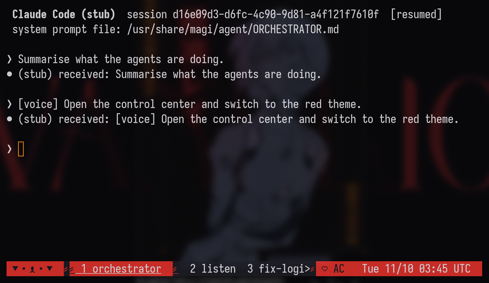
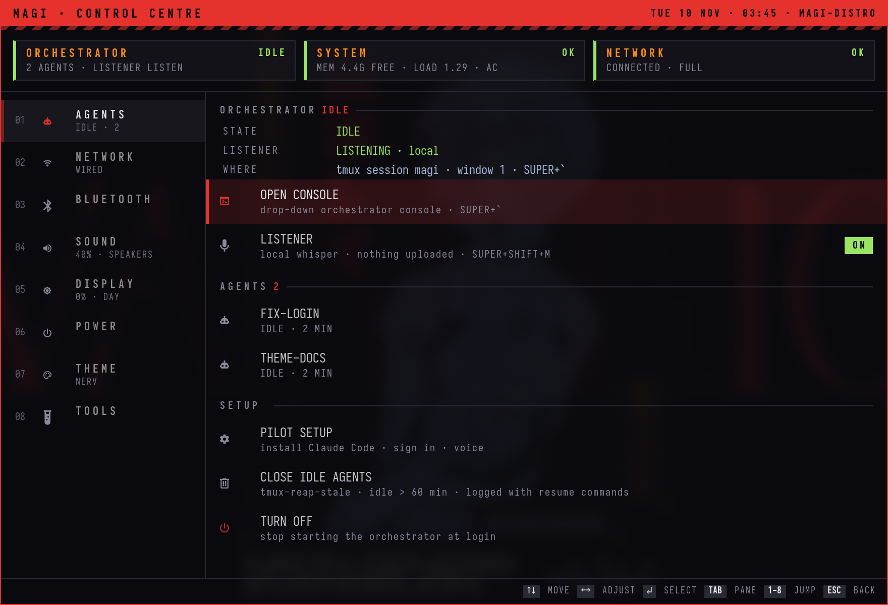
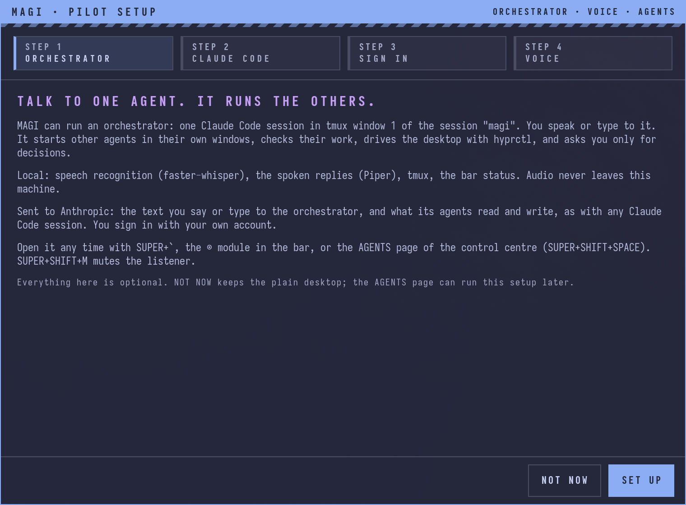
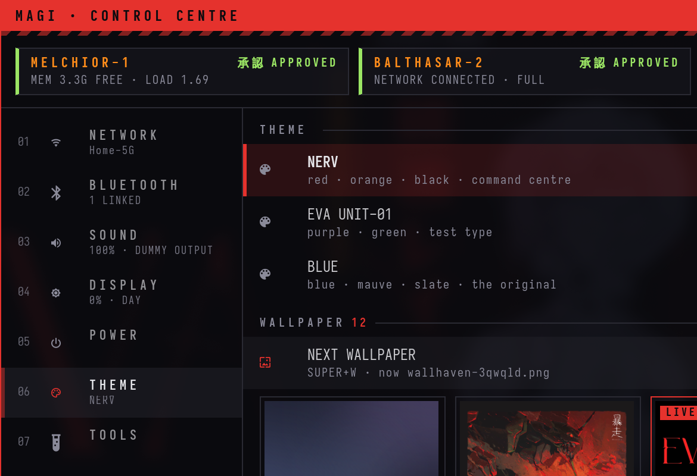
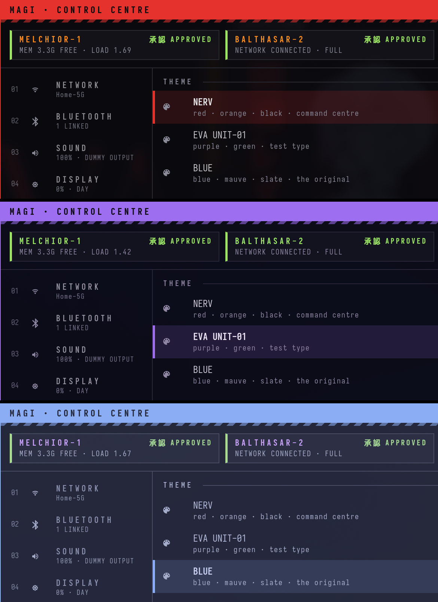
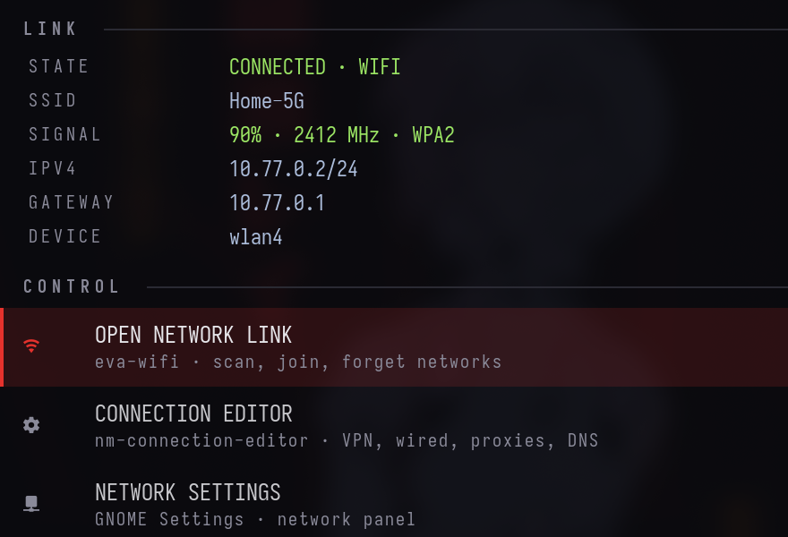
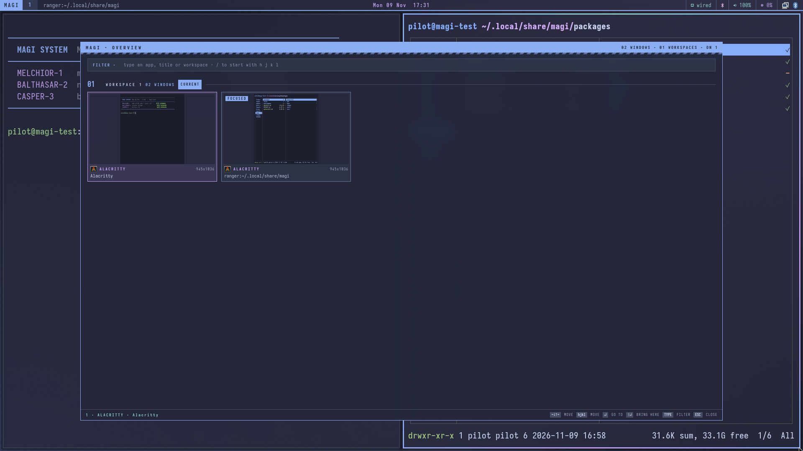
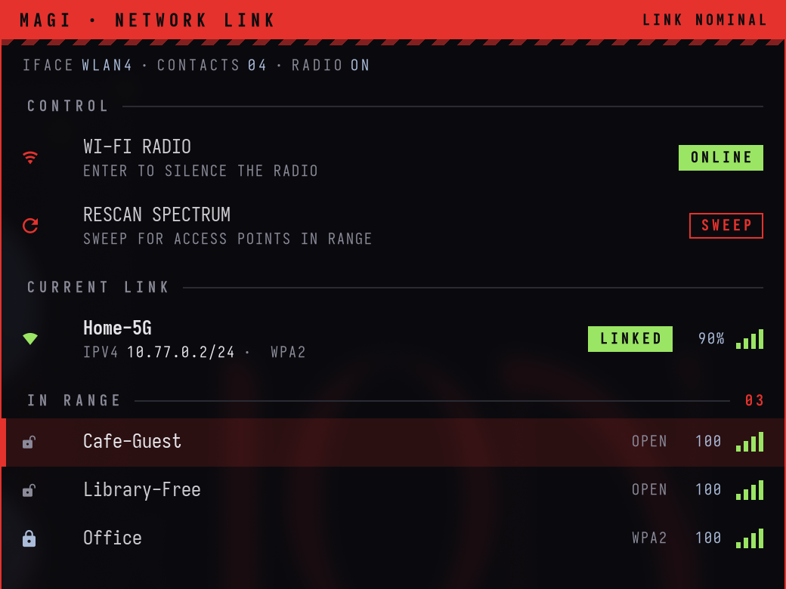
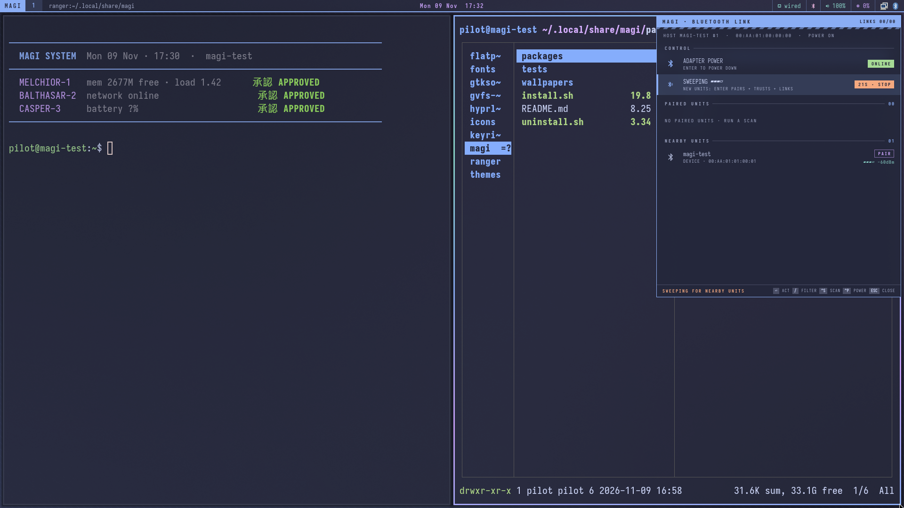

# mAGI

mAGI is a Fedora/Hyprland setup built around LLM agents. The main interface is an agent
running in tmux. You speak or type to it. It starts other agents, operates the desktop, and asks
you only for decisions. The desktop around it is Hyprland with three colour themes.



## The orchestrator

- **One agent in front.** An orchestrator agent (Claude Code, opencode, Codex, or any terminal
  agent) runs in tmux window 1 (session `magi`) and starts at login. SUPER+` drops its console over the desktop; the console also opens by
  itself at login. Other agents get their own tmux windows. The orchestrator starts them,
  checks their work, drives Hyprland through `hyprctl`, and brings you decisions.
- **Workers report back.** `magi-agent spawn` watches each worker it starts. When a worker
  finishes, stops at a permission prompt, or exits, a `[magi]` message naming the window is
  typed into the orchestrator, so it doesn't have to poll or guess.
- **Event bus.** Anything can publish a one-line event with `orch-bus emit`: workers, scripts,
  probes in the agent browser. Events reach the orchestrator when it is idle. A SQLite ledger
  records agents, open threads and decisions across reboots. See
  [Event bus and agent browser](#event-bus-and-agent-browser).
- **A browser for agents.** Chromium runs in tmux window `chrome` with DevTools on 127.0.0.1:9222,
  and the agent gets the chrome-devtools MCP server pointed at it.
- **Local voice.** A listener transcribes the microphone with faster-whisper (`base.en`) and
  types the text into the orchestrator as `[voice] …`. Replies are spoken with Piper. Both
  models are part of the image, so speech works offline and no audio leaves the machine.
  There is no wake word. SUPER+SHIFT+M mutes it.
- **Visible state.** The bar module next to the mAGI tag shows the orchestrator
  (`IDLE`, `WORKING`, `ASKING` when a prompt waits, `OFFLINE`), the number of agents, and the
  listener. The control centre's AGENTS page lists every agent and has the switches.
- **Housekeeping.** Agents idle for an hour are closed, with the resume command logged.
  After a reboot the tmux layout comes back with each session resumed. An agent with no
  resume command starts fresh.
- **Opt-in, and not bundled.** No agent is in the image. On first login, PILOT SETUP asks
  which agent to use, runs that agent's official installer, you sign in with your own
  account, and you pick a microphone. "Not now" leaves a plain desktop; `magi-agent off`
  turns it off later. Without network, everything except the agent keeps working.

| | |
|---|---|
|  |  |


The orchestrator text in these screenshots comes from a test stand-in for the agent command;
the VM was not signed in to any agent account. They were captured at 2× in the mAGI
distro test VM, installed from the ISO.

## Choosing the agent

tmux is the orchestration layer, so the orchestrator and its agents can be any terminal agent.
`send-keys`, `capture-pane` and the window layout work the same for all of them. What differs
per agent (installer, sign-in, launch, resume, how its state is read) is in
[`agent/lib/magi_agents.py`](agent/lib/magi_agents.py).

| Agent | Installed by | Resume after reboot | State read from |
|---|---|---|---|
| Claude Code | `curl -fsSL https://claude.ai/install.sh \| bash` | `claude --resume <id>` | `~/.claude/sessions/<pid>.json` |
| opencode | `curl -fsSL https://opencode.ai/install \| bash` | `opencode --session <id>` | opencode's local server API |
| Codex | `curl -fsSL https://chatgpt.com/codex/install.sh \| sh` | `codex resume <id>` | Codex's session rollout file |
| custom | your own command | starts fresh (or `AGENT_RESUME`) | the tmux pane |

Approval and permission prompts are read from the pane for every agent. Change the agent in
PILOT SETUP, or:

```bash
magi-agent use opencode                  # the orchestrator
magi-agent use --sub claude              # the agents it starts (default: same as the orchestrator)
magi-agent use custom aider --model sonnet
```

Settings live in `~/.config/magi/agent.conf` (`AGENT`, `SUBAGENT`, `AGENT_CMD`, `AGENT_ARGS`).
Claude Code gets mAGI's instructions with `--append-system-prompt-file`. The others start in
`~/.local/state/magi/orchestrator`, whose `AGENTS.md` is mAGI's
[`ORCHESTRATOR.md`](agent/ORCHESTRATOR.md). `AGENT_ARGS` passes extra flags to the
orchestrator, for example Codex's `--sandbox`: the orchestrator runs tmux and `hyprctl`, which
a tight sandbox may block. The orchestrator starts other agents with
`magi-agent spawn <window> <dir> <brief>`.

## Event bus and agent browser

Both are on by default in the image (`agent/setup.sh` turns them on for an install.sh setup).

**Event bus.** `orch-bus emit SOURCE "text"` appends one line to
`~/.local/state/orchestrator/events.jsonl`. Workers, scripts, timers and browser probes publish
there; nothing polls from the agent's side. `orch-bus.service` types whatever piled up into the
orchestrator as one `[event bus] …` line, and only when the orchestrator is idle and its input
box is empty, so nothing interrupts a turn or a half-typed message. With `BUS_DELIVERY=off` in
`~/.config/magi/agent.conf` events are only logged, and the orchestrator reads them with
`orch-bus unread`. The tmux window `bus` follows the log. Worker `[magi]` messages are logged
there too.

**Ledger and health checks.** `orch` keeps a SQLite ledger (`~/.local/share/magi/orch.db`) of
the agents the orchestrator started, open threads, standing watchers, your decisions and what
shipped, so a reboot or a compacted context loses none of it. `orch status` prints it on one
screen. Open threads are also a checklist in `~/.local/share/magi/threads.md`; tick one to close
it. `orch-doctor.timer` runs `orch doctor` every 15 minutes: user units, the tmux windows, the
agent browser, browser-bus, ledger integrity and a daily backup. It fixes what is safe and puts
the rest on the bus, once per change.

**Agent browser.** The tmux window `chrome` runs `chrome-debug`: Fedora's Chromium with its own
profile (`~/.config/chromium-agent`, seeded once from `~/.config/chromium` if you have one) and
DevTools on `127.0.0.1:9222`. It waits for the Wayland session when tmux starts before the
desktop, won't start a second copy, and comes back after a reboot with the rest of the tmux
layout. Before the orchestrator starts, `magi-agent mcp` adds the
[chrome-devtools MCP server](https://github.com/ChromeDevTools/chrome-devtools-mcp)
(`npx -y chrome-devtools-mcp@latest --browserUrl=http://127.0.0.1:9222`) to the agent's own config
(Claude Code, opencode or Codex), so agents drive this browser, where you are signed in, rather
than a blank headless one. Google Chrome isn't used because its licence doesn't allow
redistribution; `MAGI_BROWSER=google-chrome` points `chrome-debug` at it if you install it yourself.

**browser-bus.** A small daemon attaches to that browser over the DevTools protocol and runs
probes, short read-only scripts, in matching tabs. A probe calls `emit({text, key})` and the text
becomes a bus event. Probes run in an isolated JavaScript world (they see the page, not its
scripts) and report through a CDP binding, so browser-bus opens no port and the page can't call
it. Each probe has an allow-list of bus sources and a rate limit (30 events, then 15 a minute).
The default probe, `unread-titles`, reports when the unread count in a tab's title goes up, with
the site and the number only. Examples ship in `/usr/share/magi/agent/browser-bus/examples`:

```bash
browser-bus status                  # connected?, tabs with probes, recent events
browser-bus probe examples          # what ships
browser-bus probe add ./mysite.js   # install (hot-reloaded); browser-bus probe rm NAME removes it
browser-bus probe test mysite       # its live status in every matching tab
```

```js
// @match   https://status.example.com/*
// @source  status
// @purpose Tell the bus when the status page stops saying "operational"
let last = null;
setInterval(() => {
  const s = document.querySelector(".status")?.textContent.trim();
  if (last && s !== last) emit({ text: `status: ${s}`, key: s });
  last = s;
}, 5000);
```

**Security trade-off.** The debugging port listens on 127.0.0.1 only, so nothing on the network
can reach it. Any program running on this machine, as any user, can connect to it and drive that
browser with every session you are signed in to there: read pages, cookies and storage, and act
as you. That is what lets agents use it, and it is also the risk. Keep untrusted software off the
machine, sign in to only what you want agents to use, and turn it off with `BROWSER=0` in
`~/.config/magi/agent.conf` (then close the `chrome` window). Text that probes emit goes to your
orchestrator agent and its provider.

## The desktop



The control centre (SUPER + SHIFT + Space) in the NERV theme. More screenshots and short clips
are [below](#a-look-around).

GNOME stays installed. mAGI (and plain Hyprland) are extra sessions on the login screen, so
you can log out and pick GNOME again.

## Get it

**Install from the ISO (new machine or VM).** Download
[magi-44-x86_64.iso](https://archive.org/download/magi-44-x86_64/magi-44-x86_64.iso) (4.8 GB,
hosted on the Internet Archive) and write it to a USB stick or boot it in a VM.

```
sha256  cf30def4367d2395558349c4becd1c6e29806f5f5b968bbaf01c664bb5e20ebb
```

The ISO is Fedora's netinstall boot media plus the mAGI image (installed offline from the ISO)
and a kickstart. Anaconda asks for the disk; GNOME Initial Setup creates the user. The login
screen defaults to the mAGI session.

**Switch an existing Fedora Atomic system** (Silverblue, Kinoite and other Atomic editions;
not Workstation):

```bash
sudo bootc switch ghcr.io/pankajgarkoti/magi:latest
```

Updates are atomic: `sudo bootc upgrade` stages the next image, and `sudo bootc rollback`
returns to the previous one.

**Build it yourself** (podman only, no root):

```bash
podman build -f distro/Containerfile -t localhost/magi:latest .
distro/build-iso.sh --image localhost/magi:latest --out magi-44-x86_64.iso
```

See [`distro/`](distro) and the VM test in [`tests/vm/`](tests/vm).

**On an existing Fedora 44 Workstation:** `install.sh` below sets up the same desktop, with
backups and an uninstall script. The orchestrator layer is a separate opt-in step:
`agent/setup.sh` (links the tools and units, builds the local voice runtime in
`~/.local/share/magi-voice`).

## What's in it

- Hyprland 0.57 with the new Lua config, from the `sdegler/hyprland` COPR. Also hyprlock,
  hypridle, hyprpaper, hyprsunset and hyprpolkitagent.
- waybar, mako for notifications, wofi as the launcher, cliphist for clipboard history.
- `magi`, a control centre that replaces GNOME's quick settings: network, Bluetooth,
  sound devices and volume, brightness and night light, power profiles, lock/suspend/reboot
  (each one asks twice), themes and wallpapers. It stays resident, so it opens in under 100 ms.
- `magi-overview`: all windows on all workspaces as live thumbnails. Type to filter, Enter jumps.
- `eva-wifi` and `eva-bluetooth`, small keyboard pickers for Wi-Fi and Bluetooth.
- Three themes: `blue` (Catppuccin Macchiato, the default), `nerv` (red and orange on black),
  `unit01` (purple and green). Switching one restyles the bar, terminal, tmux, GTK and
  libadwaita apps, icons, the polkit prompt and the lock screen, live.
- Alacritty, tmux with a recoloured Dracula status bar, ranger, Nautilus, and the IosevkaTerm
  Nerd Font everywhere. New terminals print a short mAGI status banner (orchestrator,
  memory, network, power). `MAGI_NO_BANNER=1` turns it off.

## A look around

Everything here was captured in a throwaway Fedora 44 Workstation VM right after running the
installer, at 2× scale, and cropped to one thing per image. The Wi-Fi networks and Bluetooth
devices are simulated inside the VM.

Switching from NERV to Unit-01 on the control centre's THEME page. The few seconds the VM takes
to apply a theme are cut. ([MP4](docs/clips/theme-switch.mp4))

https://github.com/user-attachments/assets/c6d94bbf-9aad-4347-a9f7-353af367de6c

The three themes on the same page: `nerv`, `unit01`, `blue`.



Opening the control centre, then jumping to NETWORK, BLUETOOTH and SOUND. (Recorded before
the AGENTS page became section 1; those sections are now `2`, `3`, `4`.)
([MP4](docs/clips/control-centre.mp4))

https://github.com/user-attachments/assets/a23c4f63-8490-48f2-acb0-4f0d3b44d156

The NETWORK page: link details, then shortcuts to the Wi-Fi picker, the connection editor and
GNOME's network settings.



`magi-overview` (SUPER + O): every window as a live thumbnail, grouped by workspace.



Typing `naut` filters to the Files window on workspace 2; Enter jumps there.
([MP4](docs/clips/overview.mp4))

https://github.com/user-attachments/assets/49de09ae-e4ea-48fd-825a-d66681113a24

`eva-wifi` (SUPER + SHIFT + W): the current link and the networks in range, driven with `j`/`k`.
([MP4](docs/clips/wifi-picker.mp4))



https://github.com/user-attachments/assets/878598bc-4d1c-4f88-95f9-749c6f9874f4

`eva-bluetooth` (SUPER + SHIFT + B) during a scan: one paired speaker, one keyboard in range.



## Install

On a fresh **Fedora 44 Workstation**, as your normal user (not root):

```bash
bash <(curl -fsSL https://raw.githubusercontent.com/pankajgarkoti/magi/main/install.sh)
```

or from a checkout:

```bash
git clone https://github.com/pankajgarkoti/magi.git ~/.local/share/magi
~/.local/share/magi/install.sh            # add --dry-run to preview every step first
```

Then **log out**. On the login screen, pick your user, click the gear (⚙) in the corner and
choose **Hyprland**, then log in.

What the installer does, in order (each step is skipped when it is already done, so it is
safe to re-run):

1. Checks that this is Fedora and that sudo works.
2. Uses this checkout, or clones the repo to `~/.local/share/magi`.
3. Enables COPR `sdegler/hyprland`.
4. Installs the missing packages with `dnf` (the list is at the top of `install.sh`).
5. Downloads the IosevkaTerm Nerd Font from the official nerd-fonts release (checksum
   verified) into `~/.local/share/fonts`.
6. **Moves any existing file that mAGI would replace to `~/.magi-backup/<timestamp>/`**, then
   links the configs with GNU stow (`packages/*`, linked file by file).
7. Hooks `~/.bashrc.d` (Fedora's default `.bashrc` already does) and fetches tmux-sensible.
8. Generates the blue wallpaper and downloads the EVA wallpapers listed in
   [`wallpapers/manifest.tsv`](wallpapers/manifest.tsv) (sha256 checked). If you are offline they are
   skipped and the blue wallpaper is used until you re-run the installer.
9. Sets fonts and dark mode in gsettings and runs `eva-theme blue`.
10. Verifies every link, generated file, package and the Hyprland config.

Options: `--dry-run`, `--theme nerv|unit01|blue`, `--no-packages`, `--no-wallpapers`.

## Update

```bash
magi-update
```

`git pull`s the checkout, re-links the configs, installs any newly added packages, re-runs the
setup steps with your current theme, and reloads Hyprland, waybar and the mAGI panels.

## Shortcuts

SUPER does window management. Alt is left alone because tmux uses it.

| Keys | Action |
|---|---|
| SUPER + Return | Terminal (Alacritty) |
| SUPER + Space | App launcher (wofi) |
| SUPER + SHIFT + Space | mAGI control centre |
| SUPER + O | Overview / window switcher |
| SUPER + SHIFT + W / SUPER + SHIFT + B | Wi-Fi picker / Bluetooth picker |
| SUPER + SHIFT + S | Sound settings |
| SUPER + E | Files (Nautilus) |
| SUPER + R | ranger (floating terminal file manager) |
| SUPER + B | Web browser (your default) |
| SUPER + Q | Close window |
| SUPER + F / V / P / S | Fullscreen / float / pseudo-tile / toggle split |
| SUPER + h j k l (or arrows) | Move focus |
| SUPER + SHIFT + h j k l | Move window |
| SUPER + CTRL + h j k l | Resize window |
| SUPER + 1…9 / SUPER + SHIFT + 1…9 | Go to workspace / send window to workspace |
| SUPER + Tab, or tap SUPER twice | Previous workspace |
| SUPER + ` | Orchestrator console (drop-down tmux session `magi`) |
| SUPER + SHIFT + M | Mute / unmute the listener |
| SUPER + SHIFT + ` | Send window to the scratchpad |
| SUPER + A | **Window mode**: plain h j k l focus, H J K L move, arrows resize, 1–9, f, v, q; Esc leaves |
| SUPER + W | Next wallpaper |
| SUPER + SHIFT + T | Cycle theme (nerv → unit01 → blue) |
| SUPER + SHIFT + V | Clipboard history |
| SUPER + Escape | Lock screen |
| SUPER + SHIFT + E | Exit Hyprland |
| Print / SHIFT + Print | Screenshot a region to the clipboard / the screen to ~/Pictures |
| SUPER + drag / SUPER + right-drag | Move / resize a window with the mouse |
| Volume, brightness, media keys | Work as labelled |

Inside the control centre: arrows or `j k` move, `h l` adjust, Enter acts, `1`–`8` jump to a
section, Esc goes back. In the overview, type to filter, Enter jumps, Shift+Enter brings the
window here. The waybar **mAGI** badge opens the control centre (right-click cycles the theme).

## Themes

```bash
eva-theme blue      # Catppuccin Macchiato blue + mauve on slate (default)
eva-theme nerv      # NERV: red, orange, black
eva-theme unit01    # EVA Unit-01: purple and green
eva-theme toggle    # cycle (also SUPER + SHIFT + T, or the THEME page of the control centre)
```

A theme is a folder in `packages/hypr/.config/hypr/themes/<name>/` (`colors.css`, `palette`,
`theme.lua`, `alacritty.toml`, `tmux.conf`). eva-theme points `themes/current` at it and
regenerates everything that cannot read `colors.css` directly. libadwaita apps (Settings,
Files) pick up a new theme the next time they start.

## Uninstall / roll back

```bash
~/.local/share/magi/uninstall.sh          # add --dry-run to preview
```

This removes mAGI's links and generated files, removes the `~/.bashrc` loader if the
installer added one, and copies back everything from `~/.magi-backup/` (the state from
before the first install wins). Backups are never deleted; remove `~/.magi-backup` yourself
when you are happy. Packages stay installed. To remove them too:

```bash
sudo dnf remove hyprland hyprlock hypridle hyprpaper hyprsunset hyprpolkitagent waybar
sudo dnf copr remove sdegler/hyprland
```

Then pick GNOME again on the login screen.

## Layout

```
install.sh  uninstall.sh
agent/             the orchestrator layer: magi-agent, PILOT SETUP, listener, hud-say, tmux
                   snapshot/restore/reaper, user units, ORCHESTRATOR.md, voice runtime build,
                   agent adapters (lib/magi_agents.py), event bus (orch-bus), ledger and doctor
                   (orch), agent browser (chrome-debug), browser-bus (lib/browser-bus.mjs,
                   browser-bus/examples)
distro/            Containerfile (bootc image), build-iso.sh, installer kickstart + branding
packages/          stow packages, linked into ~ file by file
  hypr/            Hyprland, waybar, mako, wofi, themes, the magi/eva-* tools (~/.local/bin)
  gtk/             EVA GTK 3/4 theme sources, libadwaita colours, generators
  ranger/ alacritty/ tmux/ shell/
wallpapers/        manifest.tsv (downloaded at install) and make-blue.py (generated)
tests/             container-test.sh (podman, Fedora 44) and the VM test notes
```

## Credits

- Wallpapers are not part of this repository. The installer downloads them from
  [Wallhaven](https://wallhaven.cc); the manifest links each one's page. All rights stay with
  the original artists. *Neon Genesis Evangelion* is © khara / GAINAX; mAGI is an unofficial
  fan theme.
- tmux status bar: a lightly modified [dracula/tmux](https://github.com/dracula/tmux) (MIT),
  plus [tpm](https://github.com/tmux-plugins/tpm) (MIT), both vendored under `packages/tmux`.
- Hyprland packages for Fedora: COPR [sdegler/hyprland](https://copr.fedorainfracloud.org/coprs/sdegler/hyprland/).
- Font: [IosevkaTerm Nerd Font](https://github.com/ryanoasis/nerd-fonts).
- mAGI is a Fedora remix: it is built from Fedora packages, but it is not Fedora and is not
  produced or endorsed by the Fedora Project. Fedora's logos are replaced by `generic-logos`.
- Voice: [faster-whisper](https://github.com/SYSTRAN/faster-whisper) (MIT) with the
  `base.en` model, and [Piper](https://github.com/OHF-Voice/piper1-gpl) (GPL-3.0-or-later) with
  the `en_US-ljspeech-medium` voice (LJ Speech dataset, public domain).
- Agent browser: [Chromium](https://www.chromium.org) (BSD-3-Clause and others), Fedora's
  package. The [chrome-devtools MCP server](https://github.com/ChromeDevTools/chrome-devtools-mcp)
  (Apache-2.0) is not in the image; `npx` fetches it from npm the first time an agent uses it.
- The orchestrator can use [Claude Code](https://code.claude.com),
  [opencode](https://opencode.ai) or [Codex](https://github.com/openai/codex). mAGI does not
  include or redistribute any of them; each is installed from its publisher at first login and
  used under its publisher's terms.
