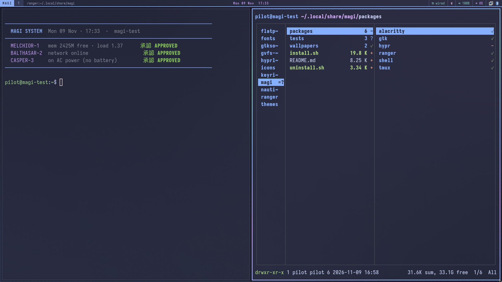
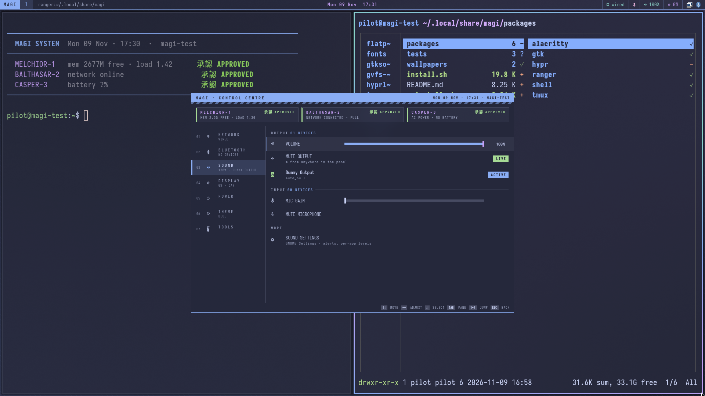
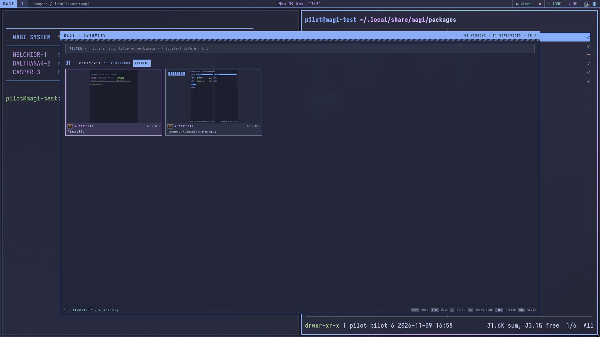
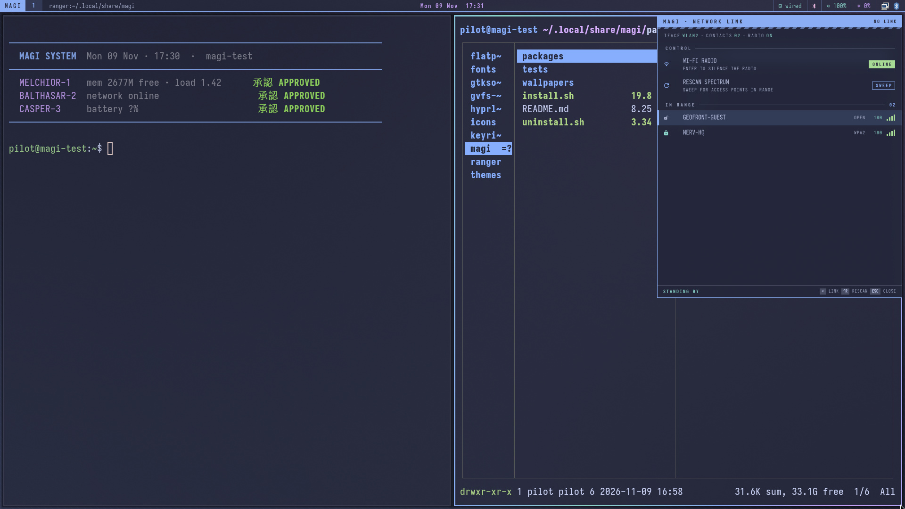
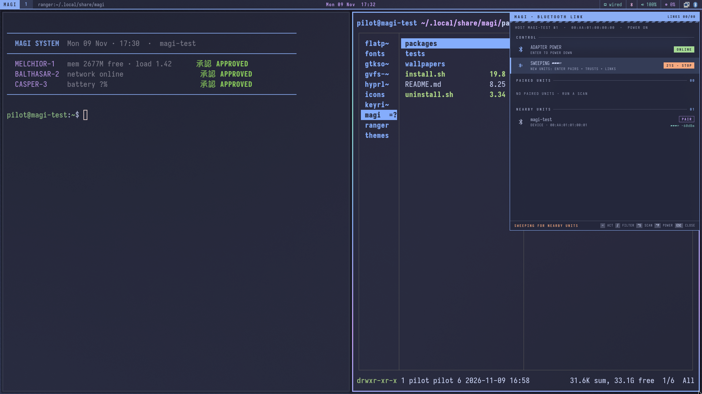
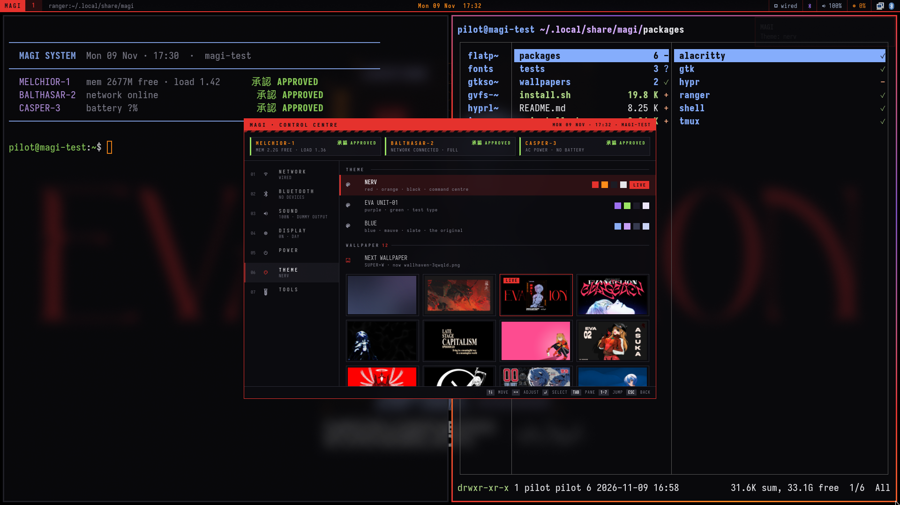
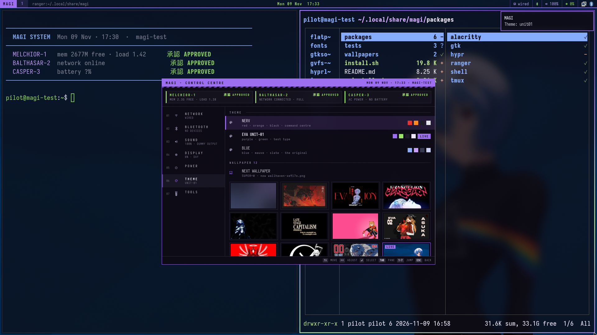

# MAGI

My Hyprland setup for Fedora 44, packaged so it installs on a fresh machine with one command.
It's themed after the MAGI computers from *Neon Genesis Evangelion*: square corners, black
glass, a hazard stripe here and there, and three colour themes you can flip between.

Every screenshot below came from a throwaway Fedora 44 Workstation VM, right after running the
installer.

| | |
|---|---|
|  |  |
|  |  |
|  |  |
|  | |

GNOME stays installed. Hyprland is just one more session on the login screen, so if you hate
it you log out and pick GNOME again.

## How this was made

Built by talking to a Claude Code session that ran a handful of agents in tmux:
[github.com/pankajgarkoti/bridge](https://github.com/pankajgarkoti/bridge).

## What's in it

- Hyprland 0.57 with the new Lua config, from the `sdegler/hyprland` COPR. Also hyprlock,
  hypridle, hyprpaper, hyprsunset and hyprpolkitagent.
- waybar, mako for notifications, wofi as the launcher, cliphist for clipboard history.
- `magi`, a control centre I use instead of GNOME's quick settings: network, Bluetooth,
  sound devices and volume, brightness and night light, power profiles, lock/suspend/reboot
  (each one asks twice), themes and wallpapers. It stays resident, so it opens in under 100 ms.
- `magi-overview`: all windows on all workspaces as live thumbnails. Type to filter, Enter jumps.
- `eva-wifi` and `eva-bluetooth`, small keyboard pickers for Wi-Fi and Bluetooth.
- Three themes: `blue` (Catppuccin Macchiato, the default), `nerv` (red and orange on black),
  `unit01` (purple and green). Switching one restyles the bar, terminal, tmux, GTK and
  libadwaita apps, icons, the polkit prompt and the lock screen, live.
- Alacritty, tmux with a recoloured Dracula status bar, ranger, Nautilus, and the IosevkaTerm
  Nerd Font everywhere. New terminals print a little MAGI vote banner (memory, network,
  battery). `MAGI_NO_BANNER=1` turns it off.

## Install

On a fresh **Fedora 44 Workstation**, as your normal user (not root):

```bash
bash <(curl -fsSL https://raw.githubusercontent.com/pankajgarkoti/magi/main/install.sh)
```

or from a checkout:

```bash
git clone https://github.com/pankajgarkoti/magi.git ~/.local/share/magi
~/.local/share/magi/install.sh            # add --dry-run to preview every step first
```

Then **log out**. On the login screen, pick your user, click the gear (⚙) in the corner and
choose **Hyprland**, then log in.

What the installer does, in order (each step is skipped when it is already done, so it is
safe to re-run):

1. Checks that this is Fedora and that sudo works.
2. Uses this checkout, or clones the repo to `~/.local/share/magi`.
3. Enables COPR `sdegler/hyprland`.
4. Installs the missing packages with `dnf` (the list is at the top of `install.sh`).
5. Downloads the IosevkaTerm Nerd Font from the official nerd-fonts release (checksum
   verified) into `~/.local/share/fonts`.
6. **Moves any existing file that MAGI would replace to `~/.magi-backup/<timestamp>/`**, then
   links the configs with GNU stow (`packages/*`, linked file by file).
7. Hooks `~/.bashrc.d` (Fedora's default `.bashrc` already does) and fetches tmux-sensible.
8. Generates the blue wallpaper and downloads the EVA wallpapers listed in
   [`wallpapers/manifest.tsv`](wallpapers/manifest.tsv) (sha256 checked). If you are offline they are
   skipped and the blue wallpaper is used until you re-run the installer.
9. Sets fonts and dark mode in gsettings and runs `eva-theme blue`.
10. Verifies every link, generated file, package and the Hyprland config.

Options: `--dry-run`, `--theme nerv|unit01|blue`, `--no-packages`, `--no-wallpapers`.

## Update

```bash
magi-update
```

`git pull`s the checkout, re-links the configs, installs any newly added packages, re-runs the
setup steps with your current theme, and reloads Hyprland, waybar and the MAGI panels.

## Shortcuts

SUPER does window management. Alt is left alone because tmux uses it.

| Keys | Action |
|---|---|
| SUPER + Return | Terminal (Alacritty) |
| SUPER + Space | App launcher (wofi) |
| SUPER + SHIFT + Space | MAGI control centre |
| SUPER + O | Overview / window switcher |
| SUPER + SHIFT + W / SUPER + SHIFT + B | Wi-Fi picker / Bluetooth picker |
| SUPER + SHIFT + S | Sound settings |
| SUPER + E | Files (Nautilus) |
| SUPER + R | ranger (floating terminal file manager) |
| SUPER + B | Web browser (your default) |
| SUPER + Q | Close window |
| SUPER + F / V / P / S | Fullscreen / float / pseudo-tile / toggle split |
| SUPER + h j k l (or arrows) | Move focus |
| SUPER + SHIFT + h j k l | Move window |
| SUPER + CTRL + h j k l | Resize window |
| SUPER + 1…9 / SUPER + SHIFT + 1…9 | Go to workspace / send window to workspace |
| SUPER + Tab, or tap SUPER twice | Previous workspace |
| SUPER + ` | MAGI scratchpad terminal (drop-down tmux) |
| SUPER + SHIFT + ` | Send window to the scratchpad |
| SUPER + A | **Window mode**: plain h j k l focus, H J K L move, arrows resize, 1–9, f, v, q; Esc leaves |
| SUPER + W | Next wallpaper |
| SUPER + SHIFT + T | Cycle theme (nerv → unit01 → blue) |
| SUPER + SHIFT + V | Clipboard history |
| SUPER + Escape | Lock screen |
| SUPER + SHIFT + E | Exit Hyprland |
| Print / SHIFT + Print | Screenshot a region to the clipboard / the screen to ~/Pictures |
| SUPER + drag / SUPER + right-drag | Move / resize a window with the mouse |
| Volume, brightness, media keys | Work as labelled |

Inside the control centre: arrows or `j k` move, `h l` adjust, Enter acts, `1`–`7` jump to a
section, Esc goes back. In the overview, type to filter, Enter jumps, Shift+Enter brings the
window here. The waybar **MAGI** badge opens the control centre (right-click cycles the theme).

## Themes

```bash
eva-theme blue      # Catppuccin Macchiato blue + mauve on slate (default)
eva-theme nerv      # NERV: red, orange, black
eva-theme unit01    # EVA Unit-01: purple and green
eva-theme toggle    # cycle (also SUPER + SHIFT + T, or the THEME page of the control centre)
```

A theme is a folder in `packages/hypr/.config/hypr/themes/<name>/` (`colors.css`, `palette`,
`theme.lua`, `alacritty.toml`, `tmux.conf`). eva-theme points `themes/current` at it and
regenerates everything that cannot read `colors.css` directly. libadwaita apps (Settings,
Files) pick up a new theme the next time they start.

## Uninstall / roll back

```bash
~/.local/share/magi/uninstall.sh          # add --dry-run to preview
```

This removes MAGI's links and generated files, removes the `~/.bashrc` loader if the
installer added one, and copies back everything from `~/.magi-backup/` (the state from
before the first install wins). Backups are never deleted; remove `~/.magi-backup` yourself
when you are happy. Packages stay installed. To remove them too:

```bash
sudo dnf remove hyprland hyprlock hypridle hyprpaper hyprsunset hyprpolkitagent waybar
sudo dnf copr remove sdegler/hyprland
```

Then pick GNOME again on the login screen.

## Layout

```
install.sh  uninstall.sh
packages/          stow packages, linked into ~ file by file
  hypr/            Hyprland, waybar, mako, wofi, themes, the magi/eva-* tools (~/.local/bin)
  gtk/             EVA GTK 3/4 theme sources, libadwaita colours, generators
  ranger/ alacritty/ tmux/ shell/
wallpapers/        manifest.tsv (downloaded at install) and make-blue.py (generated)
tests/             container-test.sh (podman, Fedora 44) and the VM test notes
```

## Credits

- Wallpapers are not part of this repository. The installer downloads them from
  [Wallhaven](https://wallhaven.cc); the manifest links each one's page. All rights stay with
  the original artists. *Neon Genesis Evangelion* is © khara / GAINAX; MAGI is an unofficial
  fan theme.
- tmux status bar: a lightly modified [dracula/tmux](https://github.com/dracula/tmux) (MIT),
  plus [tpm](https://github.com/tmux-plugins/tpm) (MIT), both vendored under `packages/tmux`.
- Hyprland packages for Fedora: COPR [sdegler/hyprland](https://copr.fedorainfracloud.org/coprs/sdegler/hyprland/).
- Font: [IosevkaTerm Nerd Font](https://github.com/ryanoasis/nerd-fonts).
